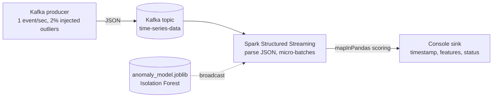

# Real-Time Anomaly Detection Pipeline

A streaming anomaly detector: a Kafka producer emits a time-series feed, and a PySpark Structured Streaming job scores every micro-batch with a pre-trained scikit-learn Isolation Forest, labeling each event `Normal` or `Anomaly`. The whole stack (Zookeeper, Kafka, Spark) runs from one `docker-compose.yml`, and it has been deployed on an Oracle Cloud VM.

## Architecture



| Service | Image | Role |
| --- | --- | --- |
| `zookeeper` | `confluentinc/cp-zookeeper:7.5.0` | Kafka coordination |
| `kafka` | `confluentinc/cp-kafka:7.5.0` | Message broker, topic `time-series-data` |
| `spark` | custom (`docker/spark`) | Runs the streaming job and the producer |

## How it works

1. **Produce.** `src/kafka_producer.py` sends one event per second with `feature1`, `feature2`, and a timestamp. Normal points are drawn from a standard normal distribution; with 2% probability a point is replaced by a 5x-scaled outlier, so the detector always has something to find.
2. **Train.** `model/model_trainer.py` fits an `IsolationForest` (`contamination=0.05`) on 1,000 synthetic points, 50 of them outliers, and saves it as `anomaly_model.joblib`.
3. **Stream.** `src/spark_stream_processor.py` reads the topic with Spark's Kafka source and parses each JSON message against a fixed schema.
4. **Score.** The model is loaded once and **broadcast** to the executors. `mapInPandas` hands each micro-batch to scikit-learn as a pandas DataFrame, so the model runs vectorized per batch instead of per row.
5. **Label.** The Isolation Forest output (`1` or `-1`) is mapped to `Normal` or `Anomaly` and written to the console sink.

## Design choices

- **Broadcast model + `mapInPandas`:** loads the model once per executor and scores in batches, avoiding per-row serialization overhead.
- **Train offline, score online:** the model is trained separately and shipped as an artifact, so the streaming job stays small and restarts quickly.
- **Docker Compose for everything:** one command brings up the broker, coordinator, and processor, which makes the pipeline reproducible on a laptop or a cloud VM.
- **Injected ground truth:** because the producer controls the outlier rate, detection behavior is easy to eyeball and test.

## Run it

**Prerequisites:** a Linux environment with Docker and Docker Compose, and `model/anomaly_model.joblib` (run `python model/model_trainer.py` to generate it).

```bash
# 1. Start Zookeeper, Kafka, and Spark
sudo docker-compose up -d --build

# 2. Start the producer (separate terminal)
sudo docker-compose exec spark python /opt/bitnami/spark/jobs/kafka_producer.py

# 3. Start the streaming job (another terminal)
sudo docker-compose exec spark /opt/bitnami/spark/bin/spark-submit \
  --packages org.apache.spark:spark-sql-kafka-0-10_2.12:3.5.1 \
  /opt/bitnami/spark/jobs/spark_stream_processor.py
```

You should see a continuous table of `timestamp`, `feature1`, `feature2`, `anomaly_status`, with roughly 1 in 50 rows flagged as `Anomaly`.

## Limitations and next steps

- The data is synthetic and the sink is the console; a real deployment would write flagged events to a topic, database, or alerting service.
- Single-node Spark and a single Kafka broker; scaling out means more partitions and executors.
- The model is static. Retraining on a schedule, or switching to an online detector, would handle drift.

## Stack

Python 3.11, Apache Kafka, PySpark Structured Streaming, scikit-learn (Isolation Forest), Docker and Docker Compose.
